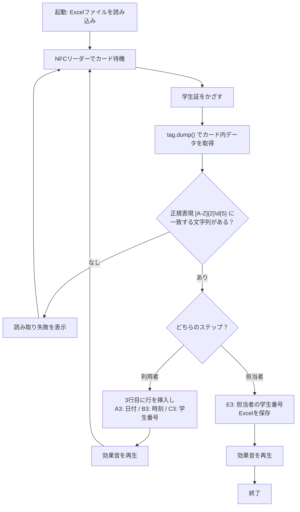

# 学生番号記録システム（Student-Number-Recording-System）

> Tap a student ID card on an NFC reader, and the student number is logged to Excel — a small automation experiment from a university IT help desk.


学生証をNFCリーダーにかざすだけで、ICチップから学生番号を読み取り、日付・時刻とあわせてExcelに記録するPythonスクリプトです。記録が終わるたびに効果音を鳴らします。

## What — これは何？

- 学生証（ICカード）をNFCリーダーにかざすと、カード内のデータから **学生番号を自動で取り出します**
- **利用者 → 担当スタッフ** の順に学生証をかざすと、1件の利用記録としてExcelに書き込みます
- 読み取りが終わるたびに **音声ファイルを再生** し、画面を見なくても成功がわかるようにしています

## Why — なぜ作ったのか

広島工業大学のICTサポートセンターで学生アルバイトをしていたとき、個人用ブースの利用記録は、学生番号を紙に手書きする運用でした。

「学生証をタッチするだけで記録できれば、もっと楽になるのでは？」と考え、学生証のICチップを使って記録を自動化する仕組みを個人で開発しました。

## Demo — 実行イメージ

利用者と担当者が順番に学生証をかざしたときのコンソール出力例です（学生番号はダミー値です）。

```text
個別ブース利用登録を行います。利用者の方は、ICカードリーダーに学生証をかざしてください。
カード情報を読み取っています。かざしたままお待ち下さい。
Student ID: AB12345
利用者登録が完了しました。続けて、担当者の学生証をかざしてください
カードが離されました。
カード情報を読み取っています。かざしたままお待ち下さい。
Student ID: CD67890
処理中です。しばらくお待ち下さい。
担当者登録が完了しました。
登録作業は完了です。プログラムを終了します。
```

学生番号が見つからないカードをかざした場合は「学生番号の読み取りに失敗しました。…」と表示され、そのまま次のカードを待ちます。

Excelには、3行目に新しい行が挿入され、次のように書き込まれます（1回の実行で1件を記録して終了します）。

| セル | 内容 | 例 |
| --- | --- | --- |
| A3 | 日付 | `2024-10-11` |
| B3 | 時刻 | `13:20` |
| C3 | 利用者の学生番号 | `AB12345` |
| E3 | 担当者の学生番号 | `CD67890` |

## How it works — 仕組み



1. `nfc.ContactlessFrontend('usb')` でUSB接続のNFCリーダーに接続し、カードがかざされるのを待ちます
2. カードを検出すると `tag.dump()` でカード内のデータをテキストとして取り出します
3. その中から、正規表現 `[A-Z]{2}\d{5}`（英大文字2文字＋数字5桁）に一致する文字列を学生番号として抽出します
4. `openpyxl` で利用記録をExcelに書き込み、`pygame` で効果音を再生します

使用ライブラリ：`nfcpy`（`import nfc`）、`openpyxl`、`pygame`、標準ライブラリの `re` / `time` / `datetime`

## Requirements — 必要なもの

- Python 3
- nfcpy が対応している USB 接続の NFC リーダー（対応機種や OS ごとのドライバ設定は [nfcpy のドキュメント](https://nfcpy.readthedocs.io/) を参照してください）
- 記録先の Excel ファイル（`.xlsx`）
- 読み取り完了時に鳴らす音声ファイル（`.mp3` など）

## Setup & Usage — セットアップと使い方

1. リポジトリを取得し、ライブラリをインストールします。

   ```bash
   git clone https://github.com/nekopath-dev/Student-Number-Recording-System.git
   cd Student-Number-Recording-System
   pip install nfcpy pygame openpyxl
   ```

2. `学生番号記録システム.py` の次の箇所を、自分の環境のファイルパスに書き換えます。

   | 行 | 設定内容 |
   | --- | --- |
   | `file_path = r"path/to/excel/file.xlsx"` | 記録先の Excel ファイル |
   | 利用者登録後の `play_sound(r"path/to/sound/file.mp3")` | 利用者登録完了時の音声ファイル |
   | 担当者登録後の `play_sound(r"path/to/sound/file.mp3")` | 担当者登録完了時の音声ファイル |

3. NFC リーダーを PC に接続してから実行します。

   ```bash
   python 学生番号記録システム.py
   ```

4. 画面の案内に従い、**利用者 → 担当者** の順に学生証をかざします。2枚目を読み取ると Excel が保存され、プログラムが終了します。

## 構想全体とこのリポジトリの範囲

構想していた運用は次のとおりです。

1. ブースの受付 PC に NFC リーダーを接続しておく
2. 利用者が学生証をかざす
3. **猫の鳴き声** とともに、学生番号が Excel の一番上の行に記録される

猫の鳴き声にしたのは、画面を見なくても読み取りに成功したことがわかる合図にするためと、利用者もスタッフも少し楽しくなる遊び心からです。

このリポジトリに含まれるのは、上記のうち **スクリプト本体** です。実際の運用で使っていた Excel ファイルと音声ファイル（猫の鳴き声）は含まれていないため、コード内のパスはプレースホルダーになっています。

## 振り返り — 導入を見送った理由と学び

完成後、自分の勤務時間に数日間、試験運用をしました。

その結果、

- 紙に手書きする場合と比べて、**記録にかかる時間はほとんど変わらなかった**
- むしろ、利用者に **学生証を出してもらう手間が増える**

ことがわかり、本格導入は見送ることにしました。

「何でもデジタルにすれば便利になる」わけではなく、手段（デジタル化）そのものが目的になってはいけない、ということを初めて実感した経験です。

この経験を踏まえ、現場の負担をより確実に減らせる施策として、紙のマニュアルを Notion に移行するプロジェクトを起案・推進し、学生スタッフ約50名の組織で導入しました。

## Notes — 注意事項

- **広島工業大学の学生証での利用を前提としています。** 学生番号の形式（`[A-Z]{2}\d{5}`）やカード内での記録のされ方は大学ごとに異なるため、他大学の学生証では読み取れない可能性があります。その場合はコード内の正規表現を変更してください。
- 本スクリプトは **個人情報（学生番号）** を扱います。記録した Excel ファイルをリポジトリにコミットしたり、第三者と共有したりしないよう注意してください。実際に運用する場合は、所属組織のルールに従ってください。
- 個人の学習・検証目的で作成したものであり、大学公式のシステムではありません。

## References — 参考

- [nfcpyを使って学生証から学籍番号を読み取る（Hatena Blog）](https://aizu-vr.hatenablog.com/entry/2019/08/02/nfcpy%E3%82%92%E4%BD%BF%E3%81%A3%E3%81%A6%E5%AD%A6%E7%94%9F%E8%A8%BC%E3%81%8B%E3%82%89%E5%AD%A6%E7%B1%8D%E7%95%AA%E5%8F%B7%E3%82%92%E8%AA%AD%E3%81%BF%E5%8F%96%E3%82%8B)
- [Zenn の記事（3w36zj6）](https://zenn.dev/3w36zj6/articles/d3894e83cb7423)

## Author

Tanasuke（[@nekopath-dev](https://github.com/nekopath-dev)）

個人開発 / 2024年10月〜12月に GitHub で公開
